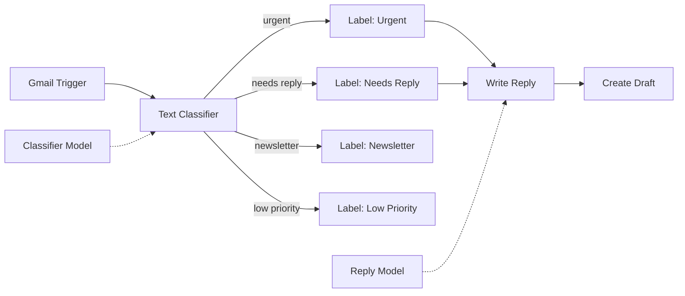

# N8N-Email-inbox-draft-replies-
# Email Inbox Cleaner + Draft Replies (n8n)

An n8n workflow that watches your Gmail inbox, sorts every new email into one of four categories with an LLM, labels it, and writes a **draft** reply for emails that need a response.

**It never sends anything.** Replies are saved as Gmail drafts for you to review.

## How it works

1. **Gmail Trigger** polls every minute for new unread emails (full message, so the body is available as `text`).
2. **Text Classifier** reads the subject, sender, and first 3,000 characters of the body, then routes the email to one of four outputs.
3. **Label nodes** apply the matching Gmail label.
4. **Urgent** and **Needs Reply** emails continue to **Write Reply**, where the LLM drafts a short, polite reply.
5. **Create Draft** saves that reply in Gmail, addressed to the sender, with the subject `Re: <original subject>`.

Newsletter and Low Priority emails are labeled only. They stay in your inbox and no draft is written.

## Categories

| Output | Meaning | Label applied | Draft written? |
|---|---|---|---|
| `urgent` | Time-sensitive, needs action today: deadlines, outages, payment problems | Urgent | Yes |
| `needs reply` | A real person expects a response, but it isn't time-critical | Needs Reply | Yes |
| `newsletter` | Newsletters, marketing, digests, promotions | Newsletter | No |
| `low priority` | Notifications, receipts, FYIs, no action needed | your own label (see below) | No |

## Requirements

- n8n (self-hosted or cloud)
- A Gmail account connected via OAuth2
- A Google Gemini API key (or any other chat model, see [Customizing](#customizing))

## Setup

1. **Create four labels in Gmail:** Urgent, Needs Reply, Newsletter, and one for low-priority mail.
   - Gmail reserves some names. **"Low Priority" and "Draft" can't be used or applied**, so use something like **FYI** or **Skim Later**.
   - Don't nest them under a parent label.
2. **Import** `email-inbox-cleaner-clean.json` into n8n (new workflow, then ⋯ menu, then *Import from File*).
3. **Reconnect credentials** on the Gmail nodes (trigger, four label nodes, Create Draft) and on both Gemini model nodes.
4. **Point each Label node at the right label.** Open the node, clear the old value, and choose your label from the *Label Names or IDs* dropdown.
5. **Test before activating** (see below). The workflow is imported as **inactive**.

## Testing

1. Open **Gmail Trigger** and click **Fetch Test Event** to pull a recent unread email.
2. Click **Execute workflow** and check that:
   - the Text Classifier sent the email down a sensible branch,
   - the label was added in Gmail,
   - for urgent / needs reply emails, a draft appeared in Gmail.
3. Repeat with a few different emails (a newsletter, a receipt, a real question) before switching the workflow to **Active**.

Start with a small batch. This workflow touches your real inbox.

## Customizing

| What | Where |
|---|---|
| Change what counts as urgent, newsletter, etc. | **Text Classifier**, category descriptions |
| Change reply tone, length, or sign-off | **Write Reply**, prompt text |
| Use a different LLM (OpenAI, Anthropic, Ollama) | Replace **Classifier Model** and **Reply Model**; both just need to connect to the AI Model input |
| Poll less often | **Gmail Trigger**, Poll Times |
| Draft replies for more categories | Connect another Label node's output to **Write Reply** |
| Archive newsletters / low priority | Add a Gmail node (*Remove Label*, `INBOX`) after those label nodes |
| Mark processed emails as read | Add a Gmail *Mark as Read* node after the label nodes |

Tip: add your role, typical tone, and things the AI should never promise (prices, deadlines, refunds) to the **Write Reply** prompt. This improves draft quality the most.

## Notes and troubleshooting

- **`Invalid label: DRAFT`:** the Label node is pointing at a Gmail system label. Choose one of your custom labels instead.
- **Can't create a label called "Low Priority":** it's reserved by Gmail. Pick another name; the workflow routes by output position, so the label name doesn't matter.
- **Empty classifier input or empty drafts:** check that the Gmail Trigger's *Simplify* toggle is **off**. The body is read from `text`, which only exists in the full format.
- **Literal `\n` appears in drafts:** change the Create Draft *Message* field to `{{ $json.text.replace(/\\n/g, '\n') }}`.
- **Check threading in Gmail:** in testing, the draft's thread ID differed from the original email's. Confirm that drafts show up inside the original conversation. If not, check the *Thread ID* option on **Create Draft**.
- **Self-sent test emails:** if you test by emailing yourself, the draft will be addressed back to you.
- **Classifier mistakes:** the classifier is only as good as its descriptions. If emails land in the wrong branch, make the category descriptions more specific for your inbox.

## Files

- `email-inbox-cleaner-clean.json`: the importable n8n workflow
- `README.md`: this file
